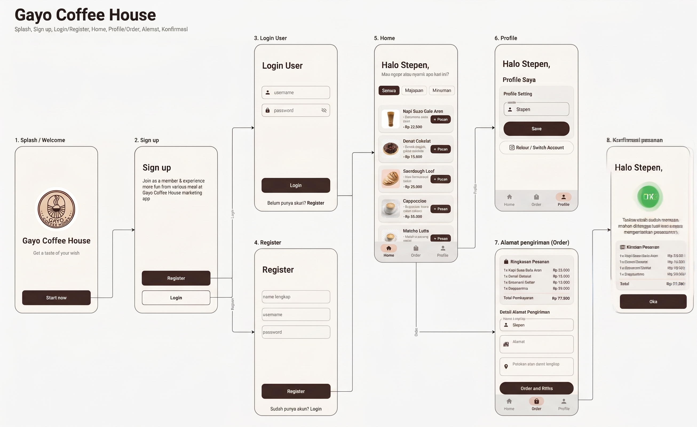

# Gayo Coffee House (Kopi dan Nyemil)

Aplikasi mobile **Gayo Coffee House** adalah aplikasi pemesanan makanan dan minuman kopi bernuansa hangat dan modern yang dikembangkan menggunakan **Jetpack Compose** dan **Material 3** untuk platform Android. Aplikasi ini dirancang berdasarkan wireframe *"Kopi dan Nyemil"* dengan antarmuka yang bersih, responsif, dan interaktif.

---

## ✨ Fitur Utama

Aplikasi ini mengimplementasikan seluruh alur dan fitur sesuai wireframe:
1. **Splash / Welcome Screen**: Halaman pembuka dengan logo kedai kopi eksklusif dan sambutan hangat *"Get a taste of your wish"*.
2. **Sign Up Screen**: Halaman pilihan awal untuk bergabung sebagai member melalui opsi **Register** atau **Login**.
3. **Login User**: Halaman autentikasi akun dengan validasi *username* & *password* (lengkap dengan toggle visibilitas password).
4. **Register Screen**: Halaman pendaftaran member baru dengan memasukkan `nama lengkap`, `username`, dan `password` yang langsung tersimpan secara dinamis di sesi aplikasi.
5. **Home Screen**:
   - Menampilkan sapaan dinamis **"Halo [Nama],"**.
   - Menyediakan filter kategori (*Semua*, *Makanan*, *Minuman*).
   - Menampilkan **7 item menu berkualitas tinggi** (Kopi Susu Gula Aren, Donat Cokelat, Sourdough Loaf, Cappuccino, Matcha Latte, Croissant Butter, dan Avocado Coffee).
   - Keranjang belanja melayang (*Floating Cart Bar*) interaktif dengan total harga dan tombol cepat menuju proses order.
6. **Profile Screen**:
   - Menampilkan informasi akun dan pengaturan profil.
   - Fitur edit nama lengkap secara instan yang langsung memperbarui sapaan di seluruh aplikasi.
   - Tombol keluar (*Logout / Switch Account*).
7. **Alamat Pengiriman (Order)**:
   - Ringkasan rincian item pesanan dan total pembayaran.
   - Form alamat pengiriman (`Nama Lengkap`, `Alamat`, dan `Patokan atau detail lengkap`).
   - Tombol **"Order dan Kirim"**.
8. **Konfirmasi Pesanan**:
   - Halaman sukses pemesanan dengan ikon centang hijau konfirmasi.
   - Pesan ramah: *"Terima kasih sudah memesan tunggu aja sebentar kurir kami segera mengantarkan pesananmu!"*.
   - Rincian nota pesanan dan alamat tujuan pengiriman.

---

## 🛠️ Teknologi yang Digunakan

- **Bahasa**: Kotlin
- **UI Framework**: Jetpack Compose & Material 3 (M3)
- **State Management**: Kotlin Coroutines, StateFlow, ViewModel (`androidx.lifecycle`)
- **Navigasi**: Jetpack Navigation Compose (`androidx.navigation.compose`)
- **Arsitektur**: Model-View-ViewModel (MVVM) Clean Architecture
- **Build System**: Gradle dengan Kotlin DSL (`build.gradle.kts`)

---

## 🚀 Cara Menjalankan Aplikasi

1. **Buka Project**:
   - Buka Android Studio (versi Jellyfish atau yang lebih baru).
   - Pilih *Open* dan arahkan ke folder `C:\Users\User\AndroidStudioProjects\gayocoffeeshop`.
2. **Sinkronisasi Gradle**:
   - Tunggu proses *Gradle Sync* selesai (pastikan koneksi internet aktif untuk mengunduh dependensi jika diperlukan).
3. **Jalankan di Emulator / Perangkat Fisik**:
   - Hubungkan perangkat Android fisik (dengan *USB Debugging* aktif) atau buat *Virtual Device (AVD)* melalui Device Manager di Android Studio.
   - Klik tombol **Run 'app'** (ikon panah hijau / `Shift + F10`) di Android Studio.

---

## 📸 Tampilan Antarmuka (Screenshots)

Berikut adalah tangkapan layar tampilan aplikasi Gayo Coffee House:

---

## 📝 Lisensi
Proyek ini dibuat untuk keperluan tugas UTS pengembangan aplikasi mobile.
